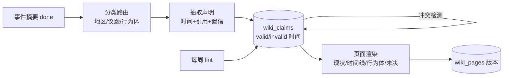

# LLM Wiki 调研：情报长期沉淀

日期：2026-10-15。类型：解释（Diátaxis）。状态：调研，未实现。

## 结论

可以做，但不照搬 Karpathy 原版（LLM 直接改写 markdown 页面）。新闻情报场景里事实会被推翻、修正，原版最大的问题——错误沉淀并扩散——在这里最严重。

建议用“声明表 + 渲染页”的混合结构：LLM 只做两件事——从事件摘要抽取带时间和引用的**声明**，以及在声明之上**生成**页面正文。声明可以失效但不删除（借 Graphiti 的双时间模型）。页面是派生产物，随时可以从声明重建。

## 1. 原版模式（Karpathy, 2026-04）

- 三层：原始资料（不可改）→ wiki（LLM 全权维护的 markdown）→ schema 文档（约定结构和流程）。
- 三个操作：ingest（一篇资料可能改 10–15 页）、query（先读 index.md，好答案回写为新页）、lint（矛盾、过时、孤页、缺链接）。
- 规模：作者称约 100 份资料、数百页时只靠 index.md 就够；更大要加检索。
- 前提：人负责挑资料、提问；作者建议业务场景保留人工审核。

## 2. 已知问题（来自批评文章，未经本项目实测）

| 问题 | 机制 | 对本项目的影响 |
|---|---|---|
| 错误扩散 | 一条错误摘要被多个页面引用，再被下游引用 | 高：新闻早期报道错误率高（`developing` 占已完成摘要的 57%） |
| 矛盾被抹平 | LLM 遇到冲突会折中改写，不报错 | 高：伤亡数、谈判条件这类数字常被修正 |
| 自我引用闭环 | wiki 页面成为后续 ingest 的“事实来源” | 中：只要禁止页面引用页面即可避免 |
| 规模 | 超过约 1000 页后 index-first 失效 | 低：种子页几十个；检索已有 Tantivy + embedding |
| 没有“编译器” | 幻觉不会让任何检查失败 | 中：可以用结构约束（每条声明必须有引用）补一部分 |

## 3. 可借鉴的工程做法

- **Graphiti（Zep）双时间模型**：每条事实带 `valid_at / invalid_at`（现实中何时成立）和 `created_at / expired_at`（系统何时记录）。新信息冲突时关闭旧事实，不删除，可以回答“10 月 1 日时我们认为是什么”。缺点：每次 ingest 多次 LLM 调用。
- **增量时间线摘要（LLM-TLS, ACL 2024；NTS-CoT, 2026）**：按日期聚类、按显著性挑节点，防止时间线变成流水账。
- **TG-RAG（2025）**：同一事实在不同时间算不同的边，避免把“10 月停火”和“3 月停火”合并。

## 4. 本项目现状（生产只读查询，2026-10-15）

- `event_digests`：done 691、failed 137、pending 121、skipped 64。近一周每天完成 18–66 份。
- 摘要 `message` 只有一句话标题级结论，`topic` 实际是标题，**没有主题或地区分类**。路由到主题页需要新增分类步骤。
- 摘要已有 `citations`、`source_article_ids`、`source_titles`、`verification_status`、`revision_type`（ADD/UPDATE/CORRECT/CONTRADICT/CONFIRM）。`revision_type` 可以直接映射为声明的新增、更新、失效。
- `event_digests.story_id` 对 `story_clusters` 是 `ON DELETE CASCADE`；保留策略删除文章后会连带删除空聚类，摘要随之消失。**改保留策略是前提。**
- OSINT 已有实体表（`osint_entities`、`osint_relations`），可以复用为行为体实体，避免再建一套实体解析。

## 5. 建议的结构

- `wiki_pages`：slug、类型、标题、渲染后的正文、版本、人工锁定标记。
- `wiki_claims`：页面、声明文本、`valid_from/valid_to`、`recorded_at/superseded_at`、被谁取代、置信、状态。
- `wiki_claim_sources`：声明 → 摘要（及文章 URL/标题快照）。规则：只能引用摘要，不能引用页面。
- 页面正文由声明重新生成，不在旧正文上增量改写；坏了就重建。

## 6. 成本估算（推断，未实测）

按每天 40 份摘要：路由约 1.5k 输入 token/份；每份平均命中 2 页，抽取声明约 3k 输入 + 0.5k 输出/页；页面重渲染按天批量做，每个变动页约 4k 输入 + 1k 输出。合计约每天 50–60 万输入、10 万输出 token，用 haiku 可承受。

## 7. 开放问题

1. 种子页清单（建议 15–25 个，按项目方向的地区局势、世界政治经济、前沿科技）。
2. 新页面是否允许自动建立，还是只提议、由人确认（建议后者）。
3. `developing` 状态的摘要是否参与：建议参与，但声明标低置信，页面“现状”段只采用 corroborated。
4. 交易情报（副方向）是否共用这套结构：先不纳入。

## 8. 验收标准（草案）

- 每条页面论断都能点开到摘要和原文快照。
- 注入一条 CORRECT 摘要后，旧声明被关闭，页面“现状”更新，历史仍可查。
- 删除全部页面后能从声明完整重建。
- 两周试运行后人工抽查 30 条声明，错误率与原摘要相当或更低。

## 来源

- Karpathy, LLM Wiki gist：https://gist.github.com/karpathy/442a6bf555914893e9891c11519de94f
- 中文解读：https://gist.github.com/acmerfight/1c26b29ef39c0acc20f2e6f1f84e025f
- 错误扩散：https://youcanbuildthings.substack.com/p/llm-wiki-maintenance-one-wrong-summary
- 漂移与闭环：https://foundanand.medium.com/the-hidden-flaw-in-karpathys-llm-wiki-e3a86a94b459
- 生产可用性批评：https://gnu.support/articles/lack-of-thinking/Critique-of-LLM-Wiki-Tutorial-Limitations-and-Production-Readiness-124404.html
- Graphiti：https://github.com/getzep/graphiti ；论文 arXiv 2501.13956
- TG-RAG：https://arxiv.org/pdf/2510.13590
- LLM-TLS：https://aclanthology.org/2024.acl-long.390.pdf
- NTS-CoT：https://arxiv.org/pdf/2606.13171
