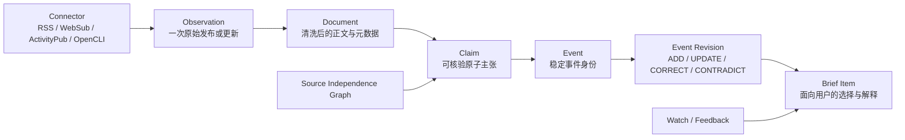
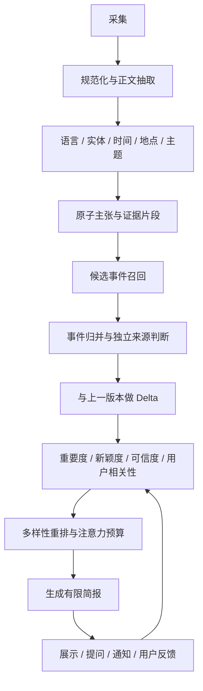

# 从 RSS 阅读器到世界信息雷达

> 状态：产品与架构重设计提案
> 日期：2026-07-12
> 范围：基于当前代码、当前本地页面和生产环境只读证据；不包含本轮实现。

## 结论

当前项目已经具备一个很强的自托管 RSS 阅读器内核：多协议采集、正文抽取、搜索、翻译、事件聚类、证据约束摘要、持久队列和安全边界都已经存在。但产品仍由旧阅读器模型控制：

```text
订阅源 -> 文章 -> 未读/已读 -> 打开单篇 -> 可选摘要
```

用户真正需要的模型应当是：

```text
世界信号 -> 事实主张 -> 持续事件 -> 新变化 -> 个性化简报 -> 追踪与提问
```

这不是一次视觉改版，而是主对象、排序目标、信息架构和数据模型的迁移。RSS 应退回到采集层，不能继续充当产品结构。

新的产品承诺是：

> 打开后 3 分钟内知道过去一段时间真正发生了什么、哪些与我有关、为什么值得关注、证据是否一致，以及下一步需要继续盯什么。

## 一、已验证的现状

### 1. 生产规模已经击穿“未读收件箱”模型

2026-07-12 的生产只读数据：

| 指标 | 当前值 | 产品含义 |
| --- | ---: | --- |
| 来源 | 17 | 来源数量不算大，问题不是订阅不足 |
| 文章 | 86,141 | 用户不可能逐篇消费 |
| 未读 | 86,037 | “未读”已失去行动意义 |
| 事件簇 | 85,427 | 大部分文章仍近似一文一事件 |
| 主题监控 | 0 | 重要能力没有进入主流程 |
| 关键词规则 | 0 | 配置成本高于用户得到的直接价值 |

近 72 小时共有 3,622 个事件簇，其中只有 199 个包含两个以上来源，约占 5.5%。当前事件聚合不足以承担“世界发生了什么”的主视图。

### 2. 首页仍是典型三栏 RSS 阅读器

当前页面的第一视觉层级是：

1. 左栏：来源、文件夹和巨大的未读数字；
2. 中栏：50 篇文章卡片；
3. 右栏：单篇正文；
4. 主题监控、关键词规则、社媒抓取都被放在设置页。

即使“今日重点”已成为默认入口，用户面对的仍是一列文章，而不是一份有限、有结构、可完成的世界简报。

### 3. 当前“质量”不等于“重要”

`article_quality_score` 主要由正文长度、作者、发布时间、抽取成功与噪声惩罚组成。`priority_score` 主要由文章质量、来源质量、多源数量、新鲜度和手工来源偏好组成。

这些信号适合回答“这篇文章是否值得读”，却无法回答：

- 这件事影响多大；
- 相比上次发生了什么变化；
- 是否突发、反常或具有长期影响；
- 是否命中用户正在追踪的实体和问题；
- 是否只是已有事件的重复报道；
- 是否应该挤掉另一个领域的事件进入有限简报。

生产列表中大量文章集中在少数相同质量分，也证明当前分数区分度有限。

### 4. 事件目前只是文章的附属字段

`story_clusters` 以标题词项、字符 bigram 和四天时间窗做相似聚类；`articles.story_id` 指向事件簇。事件没有稳定身份、版本、状态变化、事实主张、实体、纠正记录和时间线。

因此当前系统可以展示“同一事件的其他文章”，但无法可靠回答：

- 这件事从上次查看后更新了什么；
- 哪条信息是新增、修正、否认或仍有争议；
- 哪些来源只是转载同一个通讯社；
- 事件是否已经结束、升级或转向；
- 为什么此刻需要把它放进简报。

### 5. 个性化能力被拆成多个运维表单

“主题监控”“关键词规则”“来源权重”“静音来源”“关键词命中”“Telegram 推送”解决的是同一个问题：用户关心什么、何时打扰用户、用户如何反馈。

当前它们分散在设置页，要求用户理解数据源、质量阈值、扫描、规则目标和推送动作。对信息产品而言，这更像操作后台，不像用户意图模型。

### 6. 已有能力中应保留的资产

以下实现应保留并下沉为新系统的基础设施：

- Rust/axum + PostgreSQL + 持久 worker；
- RSS、Atom、JSON Feed、WebSub、ActivityPub、RSSHub、OpenCLI 和白名单网页监控；
- SSRF、防私网抓取、响应体限制、登录限流和安全 Cookie；
- 正文抽取、受控浏览器回退和内容噪声清理；
- Tantivy 搜索；
- 证据 ID、结构化主张、二阶段蕴含核验、引用回链和 fail-closed 摘要；
- 翻译侧车与原文保留；
- 任务 fencing、退避、重聚类恢复和 worker leader 机制。

## 二、新产品定义

### 核心用户任务

产品不再优化“读完所有订阅”，而优化四个任务：

1. **了解现在**：用 3、10 或 20 分钟完成一份有限简报；
2. **发现变化**：只看自上次访问以来真正新增或改变的内容；
3. **追踪问题**：长期跟踪主题、实体、事件或一个自然语言问题；
4. **核验与理解**：看到证据、来源分歧、时间线，并直接追问。

### 非目标

- 不追求成为完整的通用 RSS 客户端；
- 不以“未读清零”为成功；
- 不默认把所有抓到的内容暴露给用户；
- 不以单次 LLM 摘要代替事件建模和证据核验；
- 不把来源数量直接等同于独立事实确认；
- 不做无边界爬虫、付费墙绕过或任意命令执行。

## 三、信息架构

主导航收敛为五个用户概念：

| 入口 | 回答的问题 | 默认形态 |
| --- | --- | --- |
| **现在** | 世界和我的关注中，刚刚有什么重要变化？ | 5-12 个事件组成的限时简报 |
| **关注** | 我长期关注的主题、实体和问题发生了什么？ | Watchlist + 变化计数 |
| **追踪** | 一件持续事件目前发展到哪一步？ | 事件时间线与版本差异 |
| **探索** | 还有哪些正在升温、跨圈层或被忽略的信号？ | 主题/地区/实体/趋势探索 |
| **提问** | 基于已采集证据，我想知道什么？ | 带引用的检索增强问答 |

“来源、连接器、抓取状态、OPML、账号、模型和推送”全部进入管理区，不再占据核心消费路径。

### 首页：现在

首页不是无限文章流，而是一份可以完成的简报。

```text
┌──────────────────────────────────────────────────────────────────┐
│ 现在 · 过去 12 小时        [3 分钟] [10 分钟] [20 分钟]  搜索/提问 │
├──────────────┬────────────────────────────────┬──────────────────┤
│ 世界概览      │ 1. 事件标题                     │ 为什么值得关注   │
│ 我的关注      │    发生了什么 · 2-3 句           │ 新增/纠正/分歧    │
│ 持续追踪      │    可信度 · 5 个独立来源 · 2 小时前 │ 来源与证据        │
│ 稍后处理      │    [追踪] [少看此类] [解释]       │ 时间线与追问      │
│              │                                │                  │
│              │ 2. 事件标题 ...                 │                  │
└──────────────┴────────────────────────────────┴──────────────────┘
```

每个事件卡必须直接回答：

- **发生了什么**：一条事件级核心结论；
- **为什么现在出现**：首次发生、显著升级、重要更新、纠正或用户关注命中；
- **为什么重要**：影响范围和与用户的关系；
- **证据状态**：独立来源数、主要来源、争议和未知项；
- **相比上次的变化**：新增、更新、纠正、否认或无实质变化；
- **下一步动作**：追踪、降低此类、展开时间线、查看原始证据、提问。

### 关注：统一用户意图

用户只创建一种对象：`Watch`。

Watch 可以是：

- 主题：AI Agent、全球芯片供应链；
- 实体：OpenAI、某个国家、某个项目；
- 事件：一次选举、一场战争、某个漏洞；
- 问题：哪些信号表明某技术正在进入生产阶段？

每个 Watch 内部包含查询、实体、排除条件、重要度门槛和通知策略，但 UI 只暴露必要选项。现有 monitor、keyword rule 和 source preference 最终合并为 Watch 与 Feedback。

### 追踪：事件时间线

事件页不再以文章正文为中心，而以版本化时间线为中心：

```text
09:20 ADD         首次确认事件
10:05 UPDATE      受影响范围从 A 扩大到 B
11:40 CONTRADICT  来源 X 否认关键数字
13:10 CORRECT     官方将数字从 24 修正为 19
```

每个变化必须能回到证据片段和来源。文章是证据容器，不是页面主角。

## 四、新的领域模型

### 核心对象



建议新增或重构的表：

| 表 | 职责 |
| --- | --- |
| `sources` | 媒体、作者、组织和来源族，而不只是 feed URL |
| `source_connectors` | RSS/Hub/OpenCLI 等采集配置和运行状态 |
| `observations` | 每次抓取到的原始发布、更新或删除信号 |
| `documents` | 当前 `articles` 的兼容演进版本 |
| `entities` / `document_entities` | 人、组织、地点、产品、法规、漏洞等 |
| `claims` / `claim_evidence` | 原子主张、立场、证据片段和核验状态 |
| `events` | 稳定事件身份、状态、范围、首末时间 |
| `event_members` | 文档/主张与事件的归属及置信度 |
| `event_revisions` | 事件变化与前一版本的 delta |
| `watches` | 统一主题监控、实体追踪和自然语言问题 |
| `feedback_events` | 多看、少看、无关、已知、错误聚类等反馈 |
| `brief_runs` / `brief_items` | 某时刻、某预算下实际展示的有限简报 |
| `alert_policies` / `deliveries` | 通知门槛、冷却、投递与回执 |

### 兼容迁移

不应重写已有采集栈。迁移顺序：

1. `feeds` 保留，逐步拆成 `sources + source_connectors`；
2. `articles` 保留为文档真相源，增加实体、主张和事件成员表；
3. `story_clusters` 先兼容映射到 `events`，再逐批重算；
4. `summaries` 保持读取兼容，新写入转向 `event_revisions` 和事件快照；
5. `monitors` 与 `keyword_rules` 导入为 `watches`，旧 API 在迁移期只读；
6. 新 UI 使用 `/api/v2/*`，旧阅读器作为“全部资料”退居二级入口。

## 五、信息处理管线



### 事件匹配

标题相似度只能作为候选召回的一部分。事件匹配至少组合：

- 多语言标题与正文 embedding；
- 共享实体、时间、地点和关键数字；
- 主题分类和事件类型；
- 时间衰减与事件生命周期；
- URL、正文 hash、通讯社署名和转载模式；
- 与已有事件主张的蕴含、矛盾和新增关系。

第一版可以继续使用 PostgreSQL/Tantivy 做候选召回，再用小批量模型或 embedding 重排，避免一次性引入复杂向量基础设施。

### 来源独立性

“不同 hostname”不足以代表独立来源。应维护轻量来源图：

- 同一媒体集团；
- 同一通讯社或原始稿；
- 高正文相似度转载；
- 引用链和发布时间先后；
- 官方一手来源、现场来源、二手报道和评论。

界面可以继续显示“多个来源”，但“独立确认”必须经过来源图判断。

### 事件变化类型

每次新观察加入事件时，只生成以下有限 delta：

- `ADD`：新的关键事实；
- `UPDATE`：范围、进展或状态改变；
- `CORRECT`：旧事实被修正；
- `CONTRADICT`：可信来源出现冲突；
- `CONFIRM`：新增独立来源支持既有主张；
- `NOISE`：重复、转载或无实质变化。

只有前五类有资格重新进入“现在”或触发通知。

## 六、排序与简报生成

### 拆分当前混合分数

不要再用一个 `quality_score` 同时表达正文可读性、来源可靠性、事件重要性和用户相关性。至少拆为：

- `extraction_quality`：正文是否完整、干净、可读；
- `source_reliability`：来源历史、类型和可追溯性；
- `claim_confidence`：证据支持和独立确认；
- `event_impact`：影响人群、地域、市场、技术或制度的范围；
- `event_novelty`：相对上一事件版本的新增信息量；
- `user_relevance`：Watch、实体、历史反馈和显式优先级；
- `urgency`：随时间快速衰减的行动价值。

### 第一版候选分数

所有子分数归一化到 0-1，候选阶段可先使用：

```text
candidate =
  0.24 * user_relevance
+ 0.22 * event_impact
+ 0.16 * event_novelty
+ 0.14 * urgency
+ 0.12 * claim_confidence
+ 0.07 * source_reliability
+ 0.05 * extraction_quality
- repetition_penalty
```

这只是可解释的初始权重，最终必须由离线回放和用户反馈校准。

候选排序后再做多样性重排，避免一个主题、地区或来源占满简报。简报生成必须接受明确的“注意力预算”：3 分钟约 5 条，10 分钟约 10 条，20 分钟约 18 条，而不是固定返回 50 篇。

### 简报不是摘要列表

一次 brief run 需要记录：

- 候选集合与排除原因；
- 最终事件顺序；
- 每条被选中的解释；
- 预算、时间窗、用户画像版本；
- 当时引用的事件 revision；
- 用户是否展开、追踪、忽略、纠错或提问。

这样才能离线复盘“漏掉了什么、为什么推了这条”，而不是只看最终页面。

## 七、交互与视觉方向

### 保留

- 深色、克制、高信息密度的桌面风格；
- 键盘导航；
- 右侧上下文详情；
- 证据引用、多源列表和原文入口；
- 移动端分层浏览。

### 改变

- 品牌和导航不再出现 RSS 图标、未读总数和来源树作为第一层；
- 中栏从“文章列表”改成“事件简报”；
- 右栏默认展示“为什么重要、变化、证据、时间线”，正文进入二级标签；
- 质量数字不直接面向用户，改为可理解的证据状态；
- 设置页拆成“关注偏好”和“系统管理”，账号、OPML、连接器不再混在同一长页；
- 通过“多看/少看/已知/不相关/错误归并”收集轻量反馈，不要求用户编辑权重值。

### 可访问性要求

当前实现已有 skip link、ARIA 标签、键盘快捷键和可键盘调整的分栏，这是正确基础。重设计还需明确验证：

- 灰色次要文本在深色背景上的对比度；
- 纯图标按钮的可见标签和焦点状态；
- 事件卡、时间线和证据抽屉的语义阅读顺序；
- 不依赖颜色表达 `ADD/UPDATE/CORRECT/CONTRADICT`；
- 200% 缩放和窄屏下不出现三栏挤压；
- 动态 brief 更新需要可感知但不打断阅读的状态通知。

## 八、API 边界

建议新增事件优先的 API：

```text
GET  /api/v2/briefs/now?window=12h&budget=10m
GET  /api/v2/briefs/changes?since=<timestamp>
GET  /api/v2/events/{id}
GET  /api/v2/events/{id}/timeline
GET  /api/v2/events/{id}/evidence
POST /api/v2/watches
PATCH /api/v2/watches/{id}
POST /api/v2/feedback
POST /api/v2/ask
GET  /api/v2/sources/health
```

`/api/v2/briefs/now` 返回事件而非文章，并包含：

```json
{
  "event_id": "uuid",
  "revision_id": "uuid",
  "headline": "...",
  "what_changed": "...",
  "why_it_matters": "...",
  "change_type": "UPDATE",
  "confidence": "corroborated",
  "independent_source_count": 3,
  "disagreements": [],
  "selection_reasons": ["high_impact", "watch_match"],
  "last_updated_at": "..."
}
```

## 九、代码组织建议

当前 `apps/web/src/App.tsx` 接近 3,000 行，`styles.css` 接近 2,900 行。重设计不应继续向两个文件追加状态和页面。

建议按产品领域拆分：

```text
apps/web/src/
  app/
  features/brief/
  features/events/
  features/watches/
  features/ask/
  features/sources/
  components/evidence/
  components/layout/
  lib/api/
```

后端保持单体服务，但按领域拆分：

```text
apps/api/src/
  ingestion/
  documents/
  claims/
  events/
  briefing/
  personalization/
  delivery/
```

这不是为了抽象而抽象，而是避免“新增一个产品概念就继续修改 App.tsx、routes.rs 和 worker.rs 三个巨型文件”。

## 十、实施路线

### Phase 0：冻结旧范式扩张，建立评测基线（2-3 天）

- 停止继续添加新的阅读器式筛选和设置表单；
- 建立事件聚类回放集与每日重大事件人工基准；
- 记录当前 brief 的来源集中度、重复率、覆盖率和打开成本；
- 将“未读数”从首页主视觉移除或降级；
- 将 `quality_score` 的各类含义拆成独立字段设计。

### Phase 1：事件 Ledger（5-8 天）

- 新增 entities、claims、events、event_members、event_revisions；
- 保留现有 story cluster 做候选召回；
- 实现 `ADD/UPDATE/CORRECT/CONTRADICT/CONFIRM/NOISE`；
- 为来源独立性增加转载 hash 和来源族；
- 用生产数据离线重算，不替换现有 UI。

### Phase 2：事件级简报 API（4-6 天）

- 新增 `/api/v2/briefs/now` 和 `/changes`；
- 实现影响、新颖、可信、相关、紧急等可解释分数；
- 加入多样性重排和 3/10/20 分钟预算；
- 保存 brief run，支持离线复盘。

### Phase 3：新“现在”界面（5-7 天）

- 建立新的 app shell 和事件卡；
- 右侧实现变化、证据、分歧、时间线与原文；
- 旧阅读器移动到“全部资料”；
- 桌面、移动、键盘和 200% 缩放验证。

### Phase 4：Watch、反馈和提问（5-7 天）

- 合并 monitor、keyword rule 与 source preference；
- 增加轻反馈和基于证据的事件问答；
- 通知只对有实质 delta 且超过门槛的事件触发；
- 加入冷却、摘要去重和投递回执。

### Phase 5：生产灰度与迭代

- 新旧首页并存，通过用户开关灰度；
- 每日抽样检查错误聚类、漏报、重复、来源偏置和错误高置信；
- 只有在新简报稳定优于旧 `今日重点` 后，才移除旧入口。

## 十一、成功指标

不要再以文章数、未读数或摘要数作为核心成功指标。建议使用：

| 指标 | 目标 |
| --- | --- |
| 首个有用事件时间 | 打开后 15 秒内 |
| 3 分钟简报完成率 | 能完成，而不是无限滚动 |
| 事件级重复率 | 同一事实重复占位显著下降 |
| 重大事件覆盖率 | 对人工每日基准的 recall |
| 错误聚类率 | 不相关报道进入同一事件的比例 |
| 独立来源准确率 | “独立确认”标签的精度 |
| 变化有效率 | 被标为 UPDATE 的内容确有新信息 |
| 通知精度 | 用户保留、展开或继续追踪的通知比例 |
| 来源/主题集中度 | 简报不被单一来源或主题垄断 |
| 纠正延迟 | 错误信息被识别并标记 CORRECT 的时间 |

## 十二、必须先验证的风险

1. **聚类升级成本**：86k 文档全量 embedding 和模型处理必须做预算与批处理设计；
2. **世界重要度偏见**：影响分数可能偏向英语主流媒体，需要地区与主题覆盖约束；
3. **来源独立性误判**：转载链和媒体集团信息不完整，只能渐进提高；
4. **LLM 时效与幻觉**：模型只参与结构化提取、关系判断和表达，所有事实必须回到证据；
5. **事件身份漂移**：长期事件不能继续依赖四天标题窗口；
6. **个性化茧房**：简报必须保留一部分“公共重要事件”预算，不能全部由用户相关性控制；
7. **迁移风险**：旧 reader、搜索、OPML 和来源管理仍有价值，应渐进降级而不是删除。

## 决策

下一阶段不应继续在现有三栏阅读器上追加更多筛选、徽章或按钮。正确的第一步是实现事件 Ledger 和事件级简报 API，并让新首页围绕“变化”而不是“文章”工作。
