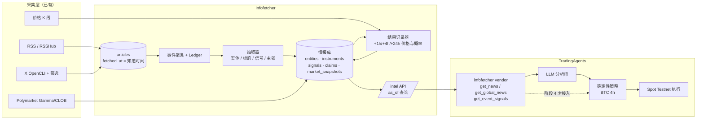
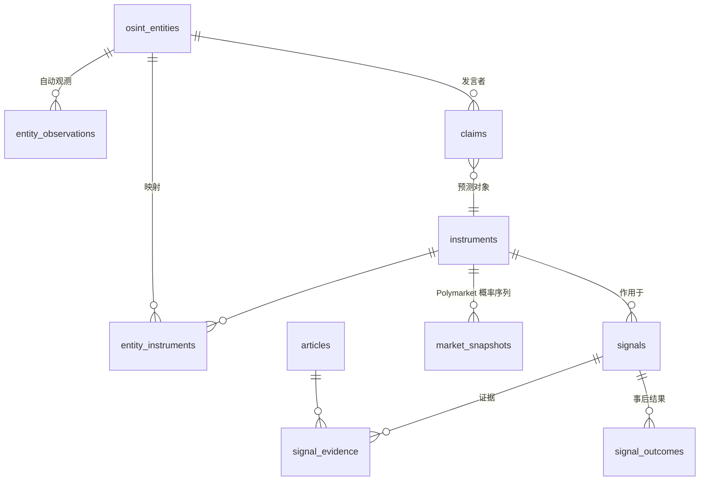
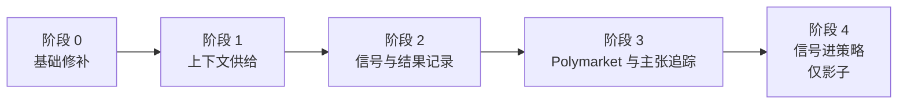

# 情报积累与交易 Agent 供给设计

更新：2026-10-13。状态：阶段 0 告警与阶段 1 已上线（见 §10），阶段 2 起未实现。

## 1. 问题与范围

infofetcher 现在只回答“最近发生了什么”。目标是再回答两类问题：

1. **积累**：某个人、项目、代币、预测市场，长期以来发生过什么，谁说过什么，后来是否兑现。
2. **供给**：在某个决策时刻，TradingAgents 能拿到哪些情报，且这些情报在当时确实已经可见。

市场范围：crypto（以 BTC 为起点）与 Polymarket。

边界：infofetcher 只产出情报，不下单。下单仍由 TradingAgents 的确定性策略执行，并继承其现有边界（Spot Testnet、影子运行、主网禁用）。

## 2. 现状差距

| 能力 | 现状 | 差距 |
|---|---|---|
| 事件聚类与 Ledger | 有，`event_revisions` 追加记录 | 重聚类会改写 `articles.story_id`，事件身份不稳定 |
| 时间点 | `articles.fetched_at` 记录抓取时间 | 没有按 `as_of` 查询的接口；`published_at` 可能晚于真实可见时间 |
| 保留 | 365 天后删除未收藏文章 | 被信号或档案引用的文章也会被删，回测证据丢失 |
| OSINT 实体 | 人工标注人物/机构/地点，挂在单个事件档案上 | 没有自动抽取、没有代币/项目/账号类型、没有跨事件时间线 |
| 交易对接 | 无 | TradingAgents 新闻来自 yfinance/alpha_vantage，Polymarket 只读 Gamma 列表 |
| 源健康 | 失败只写 `feeds.last_error` | X 曾静默断流 7 周，没有告警 |
| 鉴权 | 单一管理员 token | 没有给其他服务用的只读凭据 |

## 3. 架构

两条原则贯穿全部设计：

- **时间点正确**：每条情报带 `known_at`（系统第一次可见的时间，取 `fetched_at` 或抽取时间的较晚者）。所有对外查询都要求 `as_of`，只返回 `known_at <= as_of` 的数据。这是回测不偷看未来的唯一保证。
- **只追加**：信号、主张、市场快照只插入不修改。更正时写新行并用 `supersedes` 指向旧行，旧行保留。

## 4. 数据模型（新增）

| 表 | 关键字段 | 说明 |
|---|---|---|
| `instruments` | `kind`(crypto_asset / polymarket_market)、`symbol`(BTCUSDT) 或 `condition_id`、`resolution_text`、`end_date` | 交易标的。Polymarket 市场本身就是标的 |
| `entity_instruments` | `entity_id`、`instrument_id`、`role`(issuer / underlying / resolution_subject) | 例：SEC → BTC 现货 ETF 市场的 resolution_subject |
| `osint_entities`（扩展） | `kind` 增加 project、token、model、account | X 账号作为实体，用于信源评分 |
| `entity_observations` | `entity_id`、`article_id`、`excerpt`、`known_at`、`extractor_version`、`confidence` | 自动抽取结果，与人工确认的 `osint_mentions` 分开存，不污染人工结论 |
| `signals` | `instrument_id`、`kind`、`direction`(-1/0/+1)、`impact`(1–5)、`confidence`、`known_at`、`story_key`、`extractor_version`、`supersedes` | 结构化事件信号，见 §5 |
| `signal_evidence` | `signal_id`、`article_id`、`evidence_id`(E-…)、`excerpt` | 复用现有逐字证据与哈希校验 |
| `signal_outcomes` | `signal_id`、`horizon`(1h/4h/24h/7d)、`price_t0`、`price_t`、`prob_t0`、`prob_t` | 结果记录器按时间点写入，用于评估 |
| `claims` | `speaker_entity_id`、`statement`、`target_instrument_id`、`deadline`、`status`(open / true / false / unresolvable)、`resolved_by` | 主张与预测追踪 |
| `market_snapshots` | `instrument_id`、`captured_at`、`outcome_prices`、`volume`、`liquidity` | Polymarket 概率序列，只追加 |

保留策略：被 `signals`、`claims`、`entity_observations` 或 OSINT 档案引用的文章不参与 365 天清理，效果等同收藏。

事件身份：信号绑定 `story_key` 和证据文章，不绑定可变的 `story_id`。

## 5. 信号定义

信号只描述“发生了什么、作用于哪个标的、方向和强度”，不描述“该买还是卖”。

| `kind` | crypto 例子 | Polymarket 例子 |
|---|---|---|
| `regulatory` | SEC 起诉交易所、ETF 批准 | 影响对应裁决市场 |
| `security_incident` | 跨链桥被盗、交易所暂停提币 | — |
| `listing` | 主流交易所上币/下币 | — |
| `macro` | FOMC 决议、CPI 超预期 | 利率类市场 |
| `flow` | ETF 单日大额净流入/流出、巨鲸转账 | — |
| `resolution_evidence` | — | 直接满足或否定市场结算条件的官方事实 |
| `statement` | 关键人物公开表态 | 候选人/官员表态 |

抽取流程：

1. 事件达到证据门槛（已有逻辑）后进入抽取队列；单源事件也进队列，但信号的 `confidence` 上限为“待交叉确认”。
2. haiku 用严格 JSON Schema 输出候选信号，每条必须引用证据 ID；服务端复用摘要模块的 ID、数字和逐字校验，失败即丢弃。
3. 标的映射优先用确定性规则：代币符号表、`entity_instruments`；Polymarket 先由事件文本和市场标题做检索召回，再由模型判断是否命中 `resolution_text`，并要求引用结算条款原文。
4. 写入时 `known_at = max(证据最早 fetched_at, 抽取完成时间)`。抽取慢造成的延迟如实计入，不回填。

## 6. 对 TradingAgents 的接口

在 infofetcher 新增只读服务凭据（独立 token、只能访问 `/api/v2/intel/*`），全部接口必填 `as_of`：

| 接口 | 用途 |
|---|---|
| `GET /api/v2/intel/news?asset=BTC&as_of=&lookback_hours=` | 标的相关的已入库新闻与事件摘要，按质量排序，附原文链接 |
| `GET /api/v2/intel/global?as_of=&lookback_hours=` | 宏观与全局事件 |
| `GET /api/v2/intel/signals?instrument=&as_of=&min_impact=` | 结构化信号及证据 |
| `GET /api/v2/intel/polymarket/{condition_id}?as_of=` | 市场快照、关联事件、`resolution_evidence` 信号 |
| `GET /api/v2/intel/claims?speaker=&status=` | 主张及兑现记录、发言者命中率 |

TradingAgents 侧新增 `tradingagents/dataflows/infofetcher.py`，注册为 `news_data` 与 `prediction_markets` 的 vendor；再新增工具 `get_event_signals`。现有 vendor 路由已支持按配置切换和顺序回退，不需要改动图结构。

## 7. 评估与上线闸门

| 阶段 | 内容 | 验收标准 |
|---|---|---|
| 0 | 源连续失败 ≥3 次推 Telegram | 人为停掉 X 浏览器后 30 分钟内收到告警 |
| 1 | intel news/global 接口、只读服务 token、TradingAgents vendor、crypto 与监管信源 | 回放 30 个历史决策时刻，返回条目的 `known_at` 全部 ≤ `as_of`；token 访问非 intel 接口返回 401；BTC 报告引用 infofetcher 链接 |
| 2 | 实体/标的/信号抽取，结果记录器，被信号引用的文章免清理 | 人工标注 100 条信号：标的映射准确率 ≥ 90%，`kind` 与方向准确率 ≥ 80%；结果记录器连续 7 天无缺口 |
| 3 | Polymarket 市场关联、快照、主张追踪与信源评分 | 关联 50 个活跃市场，人工核对命中结算条款 ≥ 80%；“领先时间”报表可用（信号 `known_at` 与市场概率变动的先后） |
| 4 | 选定信号类型作为策略风控闸门（如高影响 `security_incident` / `regulatory` 时禁止开仓），只在影子模式运行 | 每个信号类型 ≥ 100 个前向样本、≥ 8 周；样本外表现优于不加闸门的基线后，才讨论 Testnet 执行 |

评估只用前向数据。历史回填的信号 `known_at` 不可信，只能用于调试，不能用于闸门判定。

## 8. 风险

| 风险 | 对策 |
|---|---|
| 未来函数（lookahead） | `as_of` 必填；回放测试作为阶段 1 验收；抽取延迟计入 `known_at` |
| 模型编造信号 | 逐字证据校验；信号只进上下文，阶段 4 前不影响下单 |
| X 上的操纵与喊单 | 账号作为实体参与信源评分；单一账号来源的信号置信度封顶 |
| 事件重聚类 | 信号绑定 `story_key` 和证据文章 |
| 成本 | 只对过证据门槛的事件抽取；同一事件按修订去抖，复用现有 30 分钟窗口 |
| 存储增长 | 被引用文章免清理会增长；阶段 0 加入容量统计 |

## 9. 待定问题

- 价格数据源：结果记录器用 Binance 公共 K 线还是 TradingAgents 已缓存的数据。
- Polymarket 范围：只跟踪与 crypto/宏观相关的市场，还是按 Watch 主题扩展到政治、科技。
- 只读服务 token 与现有单用户 session 的关系：独立表，还是配置文件。

## 10. 实施记录

### 2026-10-13：阶段 0 告警、阶段 1 上线

- **源告警**（`source_alerts.rs`）：连续失败次数达到 3 时推送一次；之前失败 ≥3 次后恢复成功时推送一次。线上尚未配置 `TELEGRAM_BOT_TOKEN` / `TELEGRAM_CHAT_ID`，目前只写 warn 日志。
- **intel 接口**（`intel.rs`）：`GET /api/v2/intel/news?asset=&as_of=&lookback_hours=&limit=` 与 `GET /api/v2/intel/global`。`known_at` = `articles.created_at`（首次入库时间，upsert 不改写）。资产命中规则：标题命中，或正文前 4000 字命中 ≥3 次；标题命中优先排序。
- **只读凭据**：`INTEL_API_TOKEN`，只能访问 `/api/v2/intel/*`；携带 Bearer 时错误不回退到会话。
- **验证**（从 OCI 经公网）：无凭据、错误凭据、intel token 访问 `/api/feeds` 和 OSINT 均返回 401；缺 `as_of`、未来 `as_of`、不支持的资产返回 400；`as_of=2026-10-10T00:00:00Z` 返回 50 条，`known_at` 全部早于 `as_of`。
- **网络边界**：Cloudflare 对 OVH 服务器自身出口 IP 返回人机验证（403），本机与 OCI 访问正常，因此没有修改 Cloudflare 规则。
- **TradingAgents**：新增 `tradingagents/dataflows/infofetcher.py` 与 `tests/test_infofetcher.py`，注册为 `get_news` / `get_global_news` 的 vendor；默认 vendor 仍是 yfinance，需要在配置中显式选用并设置 `INFOFETCHER_INTEL_TOKEN`。
- **调整**：“被引用文章免清理”移到阶段 2，因为在信号表出现前没有需要保护的引用。
